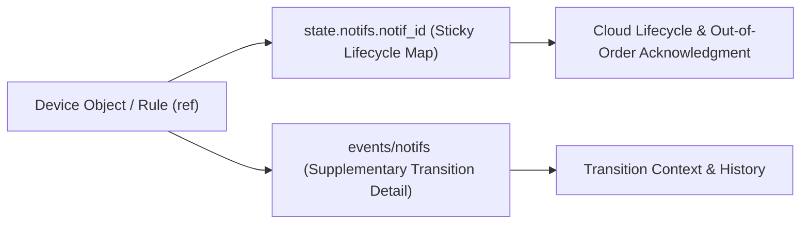

[**UDMI**](../../) / [**Docs**](../) / [**Specs**](./) / [Notifications](#)

# Notifications (`notifs`)

## Overview

The UDMI `notifs` subsystem models discrete device notifications, condition transitions, and fault states (such as BACnet intrinsic and algorithmic alarm reporting) in a protocol-neutral form.

At a high level, `notifs` separates **notification lifecycle management** from **supplementary transition detail**:

- **Lifecycle Management (`state.notifs.notif_id`)**: Defined by [state_notifs.json](../../schema/state_notifs.json) and [state_notifs_notif.json](../../schema/state_notifs_notif.json). Represents active and managed notifications as a map keyed by unique notification identifier (`notif_id`), where each entry records:
  - `ref`: Underlying device or protocol object reference (e.g., `BV11.present_value`).
  - `current`: Current condition or state string of the notification.
  - `timestamp`: RFC 3339 UTC timestamp when the notification entered its current state.
  - `status`: Optional diagnostic or operational [Entry](../../schema/entry.json) associated with the notification.
- **Supplementary Transition Detail (`events/notifs`)**: Defined by [events_notifs.json](../../schema/events_notifs.json) and [events_notifs_notif.json](../../schema/events_notifs_notif.json). Provides a streaming channel for transient metadata emitted when a transition occurs (such as transition classification, prior state, or descriptive context) without inflating the sticky `state` payload.
- **Configuration & Site Model (`config.notifs`, `metadata.notifs`)**: Defined by [config_notifs.json](../../schema/config_notifs.json) and [model_notifs.json](../../schema/model_notifs.json). Specifies expected notification targets and downlink configuration parameters.

---

## Architectural Design Rationale

The architecture of `notifs` is governed by four foundational engineering decisions that determine how devices and cloud services exchange discrete condition data reliably at scale.

### 1. Dedicated `notifs` Subsystem vs. Embedding in `pointset`

A naive design might attach transition properties (`current`, `previous`, `timestamp`, `transition`) directly to sampled points inside [events_pointset_point.json](../../schema/events_pointset_point.json), either alongside `present_value` or within a nested point sub-object.

Separating notifications into a dedicated `notifs` subblock is required for two structural reasons:

1. **Divergent Cadence and Semantics**: `pointset` models sampled scalar telemetry (`present_value`) driven by periodic intervals (`sample_rate_sec`) or analog change-of-value thresholds. Discrete notifications follow an active lifecycle (raised, acknowledged, cleared, faulted) that is orthogonal to periodic telemetry sampling. Embedding condition transitions inside `pointset` couples high-rate trend pipelines to discrete condition state machines.
2. **Notifications Without a 1:1 Telemetry Point**: In building and industrial protocols such as BACnet, notifications frequently originate from standalone alarm or algorithmic entities (e.g., BACnet Event Enrollment objects or controller fault summaries) rather than a trended `pointset` point. Modeling `notifs` as its own top-level subblock allows any notification source to be referenced via `ref` without fabricating synthetic telemetry points in `pointset`.

### 2. General Notifications (`notifs`) Rather Than Alarm-Only Scoping

While BACnet alarm reporting is a core use case, devices emit discrete notifications across a broader spectrum than traditional alarms — including manual overrides, maintenance lockouts, equipment mode transitions, and controller fault conditions. Scoping the capability as `notifs` avoids baking BACnet-specific terminology or alarm-only assumptions into UDMI's core message taxonomy while directly supporting BACnet state transitions.

### 3. `notif_id` Map vs. Ordered Event Array with Sequence Counters

Another candidate technique is modeling notifications as an ordered JSON array (`[]`) carrying a monotonic sequence counter and explicit `previous` state values to order transitions and detect dropped packets.

Keying notifications in a map (`state.notifs.notif_id`) without sequence numbers is fundamentally better suited to notification semantics:

1. **Out-of-Order Lifecycle Operations**: Notifications are inherently asynchronous and non-FIFO once active. Notification `B` may be acknowledged or cleared by an operator or local controller while earlier notification `A` remains unacknowledged. An ordered list or linear sequence counter models a strictly sequential log and breaks down when representing independent lifecycle mutations across concurrent notifications.
2. **Inherent Unique Identity (`notif_id`)**: Every notification managed by a device has an inherent unique identifier (`notif_id`). Using `notif_id` directly as the JSON map key provides O(1) per-notification addressing, guarantees uniqueness within a device's state document, and maps directly to cloud-side lifecycle tables without sequence-gap reconciliation logic.

### 4. Splitting Lifecycle (`state.notifs`) from Contextual Detail (`events/notifs`)

In UDMI, `state` messages are **sticky** (last-known-good state retained by the transport and reconciled in an idempotent manner), whereas `events` messages are **streaming** (fire-and-forget edge notifications):

- **Lifecycle belongs in `state.notifs`**: Managing active notifications requires cloud and device to converge reliably on which notifications are currently active, what `ref` they correspond to, what `current` condition they hold, and when (`timestamp`) they transitioned — even if transient MQTT packets were dropped or a downstream service restarted. Storing this compact lifecycle record (`ref`, `current`, `timestamp`, `status`) in `state.notifs.notif_id` guarantees eventual consistency.
- **Rich detail belongs in `events/notifs`**: Because UDMI republishes the complete `state` message whenever any state subblock changes, keeping `state.notifs.notif_id` entries concise prevents recurring bandwidth overhead. `events/notifs` complements `state.notifs` by providing a streaming channel for verbose, non-sticky contextual attributes (such as human-readable descriptions, transition causes, or snapshot parameters) emitted when a notification fires.

---

## Comparison of Candidate Approaches

| Design Aspect | Embedded `pointset` Fields | Sequential Event Log (`events` Array + Counter) | Split `state.notifs.notif_id` Map + `events/notifs` (**Selected**) |
| :--- | :--- | :--- | :--- |
| **Primary Location** | `events/pointset` | `events/notifs` array (`[]`) | `state.notifs.notif_id` map (`{}`) + `events/notifs` |
| **Addressing Model** | Keyed by telemetry point name | Sequential array index + sequence number | Keyed by unique `notif_id` |
| **Non-Point Notifications** | Requires synthetic telemetry points | Supported | Supported directly via `ref` |
| **Out-of-Order Acknowledgment** | Awkward; tied to telemetry updates | Poor; linear sequence conflicts with out-of-order updates | Native; each `notif_id` updates independently |
| **Packet Loss Resilience** | Depends on next periodic sample | Fragile; requires gap detection and replay | Self-healing via sticky `state` delivery |
| **Payload Overhead** | Bloats telemetry schema | Compact per event, no persistent snapshot | Compact sticky lifecycle state; rich detail isolated to `events/notifs` |

---

## Related Documentation

- [Notifs Message & Schema Reference](../messages/notifs.md)
- [Status Objects](../messages/status.md)
- [Messages Overview](../messages/readme.md)
